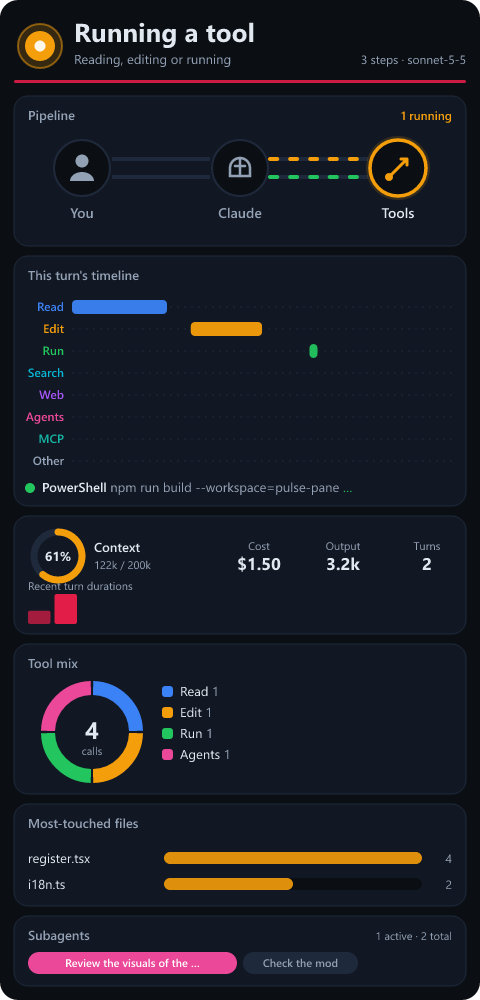

# Pulse Pane

**English summary.** Pulse Pane is a Claude Code mod that docks a live graphical
pane beside the transcript. It shows the current phase (idle, thinking, writing,
running a tool, done, aborted, error), a pipeline diagram of you, Claude and the
tools, a per-turn timeline of tool calls, context usage and cost, output tokens,
recent turn durations, a tool-mix chart, the most-touched files and sub-agents.
The pane speaks ten languages (English by default). It makes no network, file or
process calls: it only reads the events the engine already gives it. Version
1.1.0, MIT license.

- Install: `/plugin install pulse-pane --marketplace muthannaQI/pulse-pane`
- Open the pane: `/pulse`
- Change its language: `/pulse <code>`, or the plugin's `language` setting.
  Codes: `en` English, `ar` العربية, `es` Español, `fr` Français, `de` Deutsch,
  `pt` Português, `ru` Русский, `zh` 中文, `ja` 日本語, `hi` हिन्दी.
- Hide it: close the pane; it stays hidden in later sessions until you run `/pulse`.

---

## بالعربية

**Pulse Pane** لوحة حيّة رسومية تُعرض بجانب المحادثة وتُظهر ما يفعله Claude Code
لحظة بلحظة.

### ما الذي تعرضه اللوحة

- الحالة الحالية: خامل، يفكّر، يكتب، ينفّذ أداة، انتهى، أُوقف، خطأ.
- خط الأنابيب بين أنت وكلود والأدوات.
- خط زمني لاستدعاءات الأدوات في الدور الحالي.
- السياق والتكلفة ورموز الخرج ومدة آخر الأدوار.
- مزيج الأدوات (قراءة، تعديل، تنفيذ، بحث، ويب، وكلاء، MCP).
- الملفات الأكثر لمسًا والوكلاء الفرعيون.

### لقطة شاشة



*رسم اللوحة ببيانات تجريبية، بعرض 480 بكسل، أثناء تنفيذ أداة.*

### التثبيت

في جلسة Claude Code في الطرفية:

```
/plugin install pulse-pane --marketplace muthannaQI/pulse-pane
```

أجب بـ `y` لإضافة الـ marketplace، ثم اختر النطاق (user أولًا) بـ Enter.

من سطر الأوامر:

```bash
claude plugin install pulse-pane --marketplace muthannaQI/pulse-pane
```

في تطبيق Claude لسطح المكتب، حيث لا يعمل `/plugin`: اضغط + بجانب مربع
الكتابة، ثم Plugins، ثم Add marketplace واكتب `muthannaQI/pulse-pane`، ثم
Add plugin.

### الاستخدام

- الأمر `/pulse` يفتح اللوحة (ويعيدها إن كنت قد أخفيتها).
- **اللغة:** اللوحة بعشر لغات، والافتراضية الإنجليزية. للعربية اكتب `/pulse ar`،
  أو غيّر الإعداد `language` من إعدادات الإضافة. الرموز: `en` `ar` `es` `fr`
  `de` `pt` `ru` `zh` `ja` `hi`. العربية تُرسم من اليمين إلى اليسار.
- **للإخفاء:** أغلق اللوحة بنفسك. يُحفظ اختيارك فلا تُفتح تلقائيًا في الجلسات
  التالية حتى تكتب `/pulse` من جديد.

### الخصوصية

لا تُجري الإضافة أي اتصال بالشبكة، ولا تقرأ ملفات أو تكتبها، ولا تشغّل أي
عمليات. تكتفي بقراءة الأحداث التي يمنحها المحرّك لها وترسمها، وتحفظ حالتها في
مخزن الإضافة نفسه.

### الترخيص

MIT، انظر الملف [LICENSE](LICENSE).
